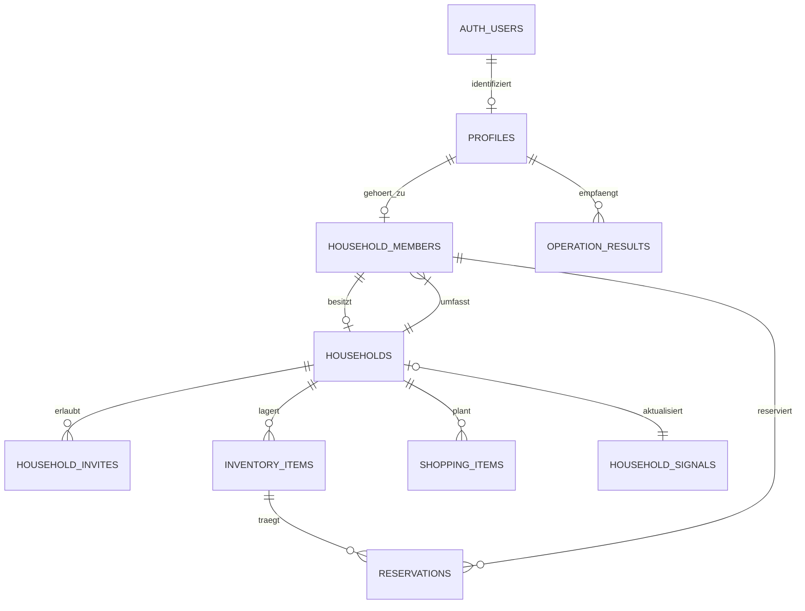

# Datenmodell für den gemeinsamen Haushalt

## Ausgeführte Migrationen 005

1. `20261125000100_household_schema.sql` erstellt `profiles`, `households`, `household_members`, `household_invites`, `private.operation_results` und `private.invite_attempts` mit den unten spezifizierten Schlüsseln, Checks und Indizes. Alle sechs gehören `postgres` und verwenden RLS. Die private Sicht `confirmed_self` projiziert höchstens die eigene bestätigte Konto-ID.
2. `20261125000200_household_rpc.sql` erstellt Ergebnistypen, private Routinen und elf öffentliche RPCs. SHA-256, UUIDv4 und Transaktionssperren sind PostgreSQL-Kernfunktionen. Nur die SQL-Tests benötigen pgTAP.

`household_members.generation uuid NOT NULL DEFAULT gen_random_uuid()` kennzeichnet jeden Beitritt. `private.operation_results.generation uuid` hält den damaligen Kontext fest. Historische Quittungen dürfen die Haushaltsauflösung bis zur Bereinigung überleben. Die Auflösung entfernt die abhängigen Fachzeilen. Vor einer administrativen Kontolöschung ist Austritt oder bestätigte Auflösung erforderlich. Danach entfernt der Auth-FK das Profil und seine Quittungen. Verbleibende Urheberschaften werden NULL.

Vorrat, Reservationen, Einkauf und Signale im folgenden Gesamtentwurf sind spätere Migrationen. [Prüfungen](TEST_REPORT.md)

Architekturvorschlag für 005, 007 und 009. Die Tabellen gehören zu PostgreSQL. Die Zugriffsmatrix steht in [SECURITY_SPEC.md](SECURITY_SPEC.md), die zulässigen Schreibpfade in [RPC_SPEC.md](RPC_SPEC.md).

## Spalten und Schlüssel

Alle Spalten sind NOT NULL, ausser wenn mit ? markiert. Ohne angegebene Vorgabe muss die Schreiboperation den Wert setzen. id bezeichnet einen UUID-Primärschlüssel mit gen_random_uuid(), ausser bei profiles. FK auf Haushalte löschen abhängige Zeilen mit CASCADE. Für veränderliche Fachzeilen bedeutet V die Spalten version bigint DEFAULT 1 CHECK (>0), created_at und updated_at timestamptz DEFAULT now(). Jede fachliche Änderung erhöht version um eins und setzt updated_at serverseitig. Das Schema enthält keine Produktstammdaten.

| Tabelle und Zweck                              | Vollständige Spalten                                                                                                                                                                                                                                           | Zusätzliche Schlüssel, Regeln und Indizes                                                                                                                                                                                                                                          |
| ---------------------------------------------- | -------------------------------------------------------------------------------------------------------------------------------------------------------------------------------------------------------------------------------------------------------------- | ---------------------------------------------------------------------------------------------------------------------------------------------------------------------------------------------------------------------------------------------------------------------------------- |
| profiles · Identität                           | id uuid PK/FK auth.users(id) ON DELETE CASCADE, display_name text, V                                                                                                                                                                                           | Kein E-Mail-Feld. Profil nach verifizierter Anmeldung mit Anzeigename anlegen, vor Haushaltserstellung/Beitritt erforderlich.                                                                                                                                                      |
| households · gemeinsamer Datenraum             | id, name text, owner_id uuid, created_by uuid?, warning_days integer DEFAULT 3, V                                                                                                                                                                              | CHECK 0–30. Zusammengesetzter FK (id,owner_id) auf household_members(household_id,user_id), DEFERRABLE INITIALLY DEFERRED, NO ACTION. Eigentümerschaft ausschliesslich aus owner_id ableiten.                                                                                      |
| household_members · Zugehörigkeit              | household_id uuid FK households, user_id uuid FK profiles ON DELETE RESTRICT, joined_at timestamptz DEFAULT now()                                                                                                                                              | PK(household_id,user_id), UNIQUE(user_id). Rolle abgeleitet, keine zweite Rollenquelle.                                                                                                                                                                                            |
| household_invites · Einladung                  | id, household_id uuid FK households, token_hash bytea, expires_at timestamptz DEFAULT (now()+7 Tage), revoked_at timestamptz?, created_by uuid?, created_at timestamptz DEFAULT now()                                                                          | UNIQUE(token_hash), CHECK 32 Bytes, expires_at > created_at, revoked_at leer oder ≥ created_at. Index (household_id,created_at). Nur Metadaten via RPC.                                                                                                                            |
| inventory_items · einzelne Charge              | id, household_id uuid FK households, name text, quantity numeric DEFAULT 1, unit text DEFAULT 'Stück', category text DEFAULT 'Sonstiges', location text?, expiry_date date?, date_type text?, barcode text?, status text DEFAULT 'active', created_by uuid?, V | UNIQUE(household_id,id), Index (household_id,status,expiry_date,id). Status active mit positiver Menge oder consumed mit genau 0. Verbraucht bleibt für Konflikterkennung archiviert. Fehlerhaftes Los darf die Löschoperation entfernen. Keine automatische Zusammenführung.      |
| reservations · eigene Teilmenge                | id, household_id uuid, inventory_item_id uuid, user_id uuid, quantity numeric, created_at und updated_at timestamptz DEFAULT now()                                                                                                                             | FK(household_id,inventory_item_id) auf inventory_items(household_id,id), FK(household_id,user_id) auf household_members, beide CASCADE. UNIQUE(inventory_item_id,user_id), Index (household_id,user_id). Menge >0 bis 9999. Freigabe löscht die Zeile. Versionsschutz über Charge. |
| shopping_items · offene und erledigte Einkäufe | id, household_id uuid FK households, name text, quantity numeric?, unit text?, checked boolean DEFAULT false, V                                                                                                                                                | Index (household_id,checked,id). Menge und Einheit zusammen gesetzt oder beide NULL, Mengenregeln wie beim Bestand. Löschen entfernt nur den Einkaufswunsch.                                                                                                                       |
| private.operation_results · Wiederholschutz    | user_id uuid FK profiles ON DELETE CASCADE, operation_id uuid, operation text, request_hash bytea, household_id uuid?, result jsonb, created_at timestamptz DEFAULT now()                                                                                      | PK(user_id,operation_id), Länge Hash 32, Index created_at. Haushalt als historischer Geltungsbereich ohne FK, Antwort nur minimale Quittung. Ablauf siehe RPC-Vertrag.                                                                                                             |
| household_signals · Änderungsanzeige           | id uuid PK (= households.id, ohne FK), revision bigint DEFAULT 1 CHECK (>0)                                                                                                                                                                                    | Pro Haushalt ein unabhängiger Zähler. Keine Nutzdaten. Nur UPDATE-Signale abonnieren. Nach Auflösung unverknüpfte UUID dauerhaft reserviert lassen, keine DELETE-Ereignisse. Zugriff nur bei lebender Mitgliedschaft.                                                              |

Alle created_by-Spalten referenzieren profiles(id) ON DELETE SET NULL. Austritt erhält die Urheberschaft. Kontolöschung verlangt zuerst regulären Austritt oder bestätigte Auflösung, damit ein Auth-Administrationsvorgang keinen bewohnten Haushalt verwaisen lässt. Löschung des einzigen Haushalts entfernt Mitgliedschaften und alle Fachdaten in derselben Transaktion. PK und UNIQUE erzeugen die benötigten eindeutigen Indizes. Querverweise auf created_by dienen keiner Berechtigungsprüfung.

## Validierung vor dem Schreiben

UI und RPC erhalten identische Grenzwert-Fixtures aus F10. Namen (auch Anzeige und Haushalt) an beiden Enden von Leerraum befreien und 1–100 Unicode-Codepunkte prüfen. DB-CHECK verlangt kanonische, bereits getrimmte Namen. UI akzeptiert Punkt oder Komma, übermittelt Dezimalzahlen als exakte Dezimalzeichenfolge. RPC prüft Syntax, zulässige Nachkommastellen und Wertebereich vor Typumwandlung. Für Zählmengen nur ganze Werte, kg und Liter höchstens drei Nachkommastellen. CHECK auf unbeschränktem numeric, endlichem Wert, Obergrenze 9999 und Einheitengenauigkeit. Keine numerische Spalte mit fester Skala. Bei Reservierungen Einheit unter Chargensperre lesen. API-Endpunkte dürfen falsche Präzision, auch bei der Warnfrist, nicht durch implizite Umwandlung verlieren.

| Kategorie                                                   | Zulässige Einheiten       |
| ----------------------------------------------------------- | ------------------------- |
| Früchte/Gemüse, Fleisch/Fisch, Brot/Backwaren, Trockenwaren | Stück, Packung, kg        |
| Getränke                                                    | Stück, Packung, Liter     |
| Milchprodukte, Sonstiges                                    | Stück, Packung, kg, Liter |

CHECK erzwingt die Paare, Lagerort NULL oder Kühlschrank/Gefrierfach/Vorratsschrank/Sonstiges. Barcode NULL oder 13 ASCII-Ziffern mit gültiger EAN-13-Prüfziffer, führende Nullen erhalten. expiry_date und date_type gemeinsam NULL oder gültiges Kalenderdatum und MHD/Verbrauchsdatum/unbekannt. Gegen das heutige Kalenderdatum in Europe/Zurich beim Schreiben eines neuen/geänderten Datums prüfen. Bis einschliesslich +5 Kalenderjahre ohne Rückfrage, danach ausdrückliche Bestätigung zum konkreten Datum, über +20 ablehnen. Bei Schalttag auf Monatsende begrenzen. Keine zeitabhängige CHECK-Bedingung. Vergangene Daten erlaubt. Barcode liefert weder Datum noch Datumsart.

## Beziehungen

## Migrationsfolge und Abnahme

005 erstellt zuerst Profile und Haushalte, danach Mitgliedschaften und den verschobenen Owner-FK. Haushalt und erste Mitgliedschaft entstehen gemeinsam. Die eindeutige Mitgliedschaft verhindert auch zwei erfolgreiche parallele Erstellungen. Anschliessend Einladungen, Quittungen, Grants, RLS und Haushalts-RPCs in derselben migrationsgebundenen Freigabe. 007 ergänzt Chargen und Reservierungen gemeinsam mit den gesicherten Schreibpfaden. 009 ergänzt Einkauf und Änderungsanzeige, initialisiert je bestehendem Haushalt eine Zeile und aktualisiert alle betroffenen RPCs. Tabellen nie vor ihren Rechten exponieren. Jede Stufe von leerer DB und als Upgrade vom Vorgänger testen. [PostgreSQL zu numerischen Typen](https://www.postgresql.org/docs/current/datatype-numeric.html)

Die zusätzliche interne Tabelle private.invite_attempts zählt Vorschau- und Einlösungsversuche gemeinsam. Sie gehört zu Migration 005. Primärschlüssel, Typen, Grenzen, FK, Löschregeln und Berechtigungen stehen im Abschnitt «Einladungen» der [Sicherheitsspezifikation](SECURITY_SPEC.md).
